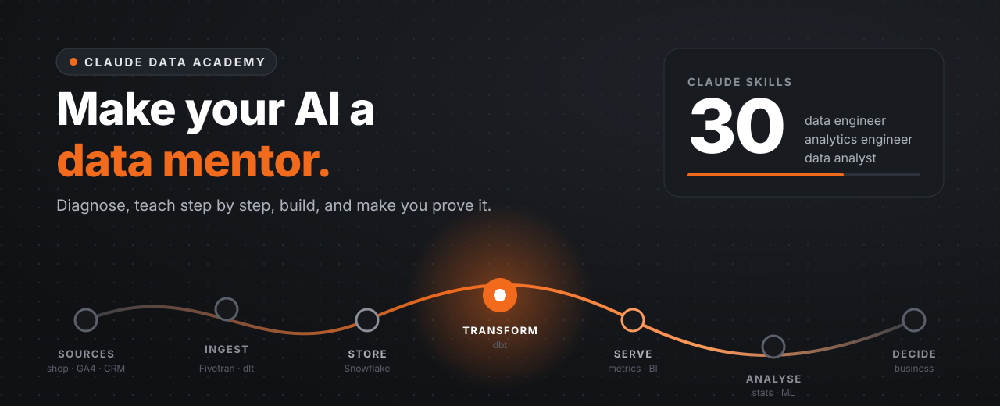

<p align="center">
  
</p>

<h1 align="center">Claude Data Academy</h1>

<p align="center">
  <strong>Complete Claude skills for learning data: from your first <code>SELECT</code> to the boardroom.</strong><br>
  Make your AI better than everyone else's.
</p>

<p align="center">
  <a href="https://github.com/andersvlindberg/claude-data-academy/actions/workflows/validate.yml"></a>
  
  
  
</p>

<p align="center">
  <a href="#install-in-60-seconds">Install</a> ·
  <a href="#see-the-difference">See the difference</a> ·
  <a href="#the-30-skills">The 30 skills</a> ·
  <a href="CURRICULUM.md">Curriculum</a> ·
  <a href="projects/capstone">Capstone</a>
</p>

---

Ask a normal AI how a LEFT JOIN works and you get an essay you'll forget by tomorrow. Ask a Claude running **Claude Data Academy** and it finds out what you already know, teaches you one step at a time, makes you do the last step yourself, and checks that you can prove it.

30 skills cover the **whole data chain**, not one tool:

```
 SOURCES ──► INGEST ──► STORE ──► TRANSFORM ──► SERVE ──► ANALYSE ──► DECIDE
 shop, GA4,   Fivetran,   Snowflake   dbt (ELT),    BI, CRM,   stats, ML,   business case,
 CRM, apps    dlt                     tests, docs   reverse    AI agents    customer journey
                                                    ETL
 └──── data engineer ────┘└──── analytics engineer ────┘└──── data analyst ────┘
            orchestrated by Dagster · versioned in Git · governed by GDPR
```

## Why it's different

| A normal AI assistant | Claude with Claude Data Academy |
|---|---|
| Answers immediately, at one generic level | **Diagnoses first**, then teaches at your level |
| Dumps the full solution | **One step per turn**, you do the last step |
| Writes your homework if you ask | **Academic integrity built in**: explains and reviews, never writes graded hand-ins |
| Forgets what you learned | **Learning log** and spaced review (+1 day, +1 week, +1 month) |
| Knows tools in isolation | Connects everything to the **chain and the business decision** |
| Says "it depends" | **Opinionated conventions**: dbt layers, naming, tests, metric definitions, contact policies |
| Confident about outdated facts | Flags fast-changing facts with **"verify in current docs"** |
| Never asks for proof | Every answer ends with **how to verify it** |
| Runs whatever you ask | **Safe by default**: explains and waits for your yes before anything touching personal data, production or anything irreversible |
| Treats privacy as an afterthought | **Privacy first**: a GDPR handbook, a data collection checklist and cookie rules built in |

## See the difference

> **You:** explain window functions

<details open>
<summary><strong>Claude with the academy</strong></summary>

> **Claude:** Quick check so I pitch this right: have you used `GROUP BY` to sum revenue per customer? If yes, what happens to the individual order rows when you do that?
>
> **You:** they get squashed into one row per customer
>
> **Claude:** Exactly. A window function does the same calculation **without squashing the rows**. Same orders table, but now every order keeps its row and gets the customer's total next to it:
>
> ```sql
> select order_id, customer_id, order_total,
>        sum(order_total) over (partition by customer_id) as customer_total
> from orders
> ```
>
> | order_id | customer_id | order_total | customer_total |
> |---|---|---|---|
> | 1 | A | 500 | 1 200 |
> | 2 | A | 700 | 1 200 |
> | 3 | B | 300 | 300 |
>
> Your turn: what would you add inside `over (...)` so `customer_total` becomes a *running* total in date order?

</details>

## Install in 60 seconds

**Claude apps (claude.ai, desktop): all 30 skills at once**
1. Go to **Customize → Plugins → Add → Add marketplace → Add from a repository**.
2. Enter `andersvlindberg/claude-data-academy`.
3. Install the **claude-data-academy** plugin. Done.

**Claude Code: two commands**
```bash
claude plugin marketplace add andersvlindberg/claude-data-academy
claude plugin install claude-data-academy@claude-data-academy
```

**Prefer single skills?** Download individual zips from the [latest release](https://github.com/andersvlindberg/claude-data-academy/releases/latest) and upload them under **Customize → Skills**, or copy folders from `skills/` into `~/.claude/skills/`.

Then just ask. Skills load automatically when your question matches:

```
"Teach me incremental models in dbt"          → ae-coach + ae-dbt
"Quiz me on GDPR legal bases, 5 questions"    → ae-coach + ae-governance-gdpr
"Design an abandoned-cart flow with a holdout" → ae-crm-automation
"Mock interview me for an analytics engineer role" → ae-coach + ae-career
"Build the staging model for orders in my project" → ae-dbt (build mode)
```

## The 30 skills

**The focus is the core data career path: data engineer → analytics engineer → data analyst.** Around it sits breadth that every strong data person needs: CRM, marketing automation, MarTech, BI, design and business, taught from a business perspective, because the people who get hired understand why the data matters, not just how to move it.

**The engine**
| | Skill | What it does |
|---|---|---|
| 00 | [`ae-coach`](skills/ae-coach) | Learn, build, quiz, review and interview modes. Diagnosis, step-by-step scaffolding, learning log, academic integrity |

### Core track

**Data engineer**
| | Skill | Covers |
|---|---|---|
| 04 | [`ae-data-engineering`](skills/ae-data-engineering) | Ingestion with Fivetran and Python, ELT, idempotency, backfills, Dagster/Airflow, Docker, migration |
| 06 | [`ae-warehouses`](skills/ae-warehouses) | Snowflake, BigQuery, DuckDB, cloud platforms, cost control, roles, key pair auth |
| 13 | [`ae-apis`](skills/ae-apis) | REST, auth, pagination, retries, webhooks, integration patterns, reverse ETL |
| 14 | [`ae-python`](skills/ae-python) | Python for data, pandas, object-oriented programming (classes), testing with pytest, Python ↔ C# |
| 16 | [`ae-git-devops`](skills/ae-git-devops) | Git, GitHub, pull requests, CI/CD for dbt, linting |
| 26 | [`ae-systems-processes`](skills/ae-systems-processes) | ERP, OMS, WMS, PIM, CMS, order to cash, master data, migration |

**Analytics engineer**
| | Skill | Covers |
|---|---|---|
| 01 | [`ae-foundations`](skills/ae-foundations) | The data lifecycle, roles, observation vs interpretation |
| 02 | [`ae-sql`](skills/ae-sql) | SELECT to window functions, patterns, dialects |
| 03 | [`ae-modeling`](skills/ae-modeling) | Grain, keys, star schemas, Kimball, SCD |
| 05 | [`ae-dbt`](skills/ae-dbt) | Layers, tests, docs, macros, incremental, snapshots, CI, GA4 in dbt, certification prep |
| 11 | [`ae-bi-metrics`](skills/ae-bi-metrics) | Metric definitions, semantic layer, dashboards |
| 12 | [`ae-governance-gdpr`](skills/ae-governance-gdpr) | GDPR, consent, PII, data ethics, data quality, data contracts |
| 19 | [`ae-mcp-tooling`](skills/ae-mcp-tooling) | MCP, safe AI access to warehouses, dbt and GitHub |
| 29 | [`ae-claude-code`](skills/ae-claude-code) | Claude Code for data work: CLAUDE.md, plan mode, skills, commands, subagents, hooks, CI |

**Data analyst**
| | Skill | Covers |
|---|---|---|
| 07 | [`ae-web-tracking`](skills/ae-web-tracking) | Click to data: HTTP, DevTools, cookies, identity, data layer, GTM, consent, JavaScript |
| 10 | [`ae-analytics`](skills/ae-analytics) | EDA, funnels, cohorts, RFM, A/B tests, root cause analysis |
| 15 | [`ae-ai-ml`](skills/ae-ai-ml) | Churn and CLV models, leakage, LLMs, RAG, agents, company brain |
| 23 | [`ae-digital-analytics`](skills/ae-digital-analytics) | Measurement plans, GA4, CRO, UTMs, attribution, GA certification |
| 24 | [`ae-statistics`](skills/ae-statistics) | Inference, experiment design, power, regression, surveys |
| 28 | [`ae-spreadsheets`](skills/ae-spreadsheets) | Excel and Google Sheets: XLOOKUP, SUMIFS, pivots, Power Query, when to move to dbt |

### Breadth track (business perspective)

| | Skill | Covers |
|---|---|---|
| 08 | [`ae-martech`](skills/ae-martech) | The MarTech stack, KPI math, attribution, organisation, brand and CX |
| 21 | [`ae-crm-automation`](skills/ae-crm-automation) | CRM, lifecycle, lead scoring, service data, automation flows, holdouts, golden records |
| 22 | [`ae-customer-data-platforms`](skills/ae-customer-data-platforms) | Data flows, CDP, identity resolution, customer 360, activation, adtech |
| 09 | [`ae-business-journeys`](skills/ae-business-journeys) | Customer journeys, touchpoints, metric trees, business cases |
| 25 | [`ae-business-strategy`](skills/ae-business-strategy) | Business acumen, Business Model Canvas, SMART goals, KPIs, data maturity |
| 27 | [`ae-design`](skills/ae-design) | Design direction for decks, dashboards, reports and UI |
| 18 | [`ae-presentation-design`](skills/ae-presentation-design) | Data storytelling, decks, presenting |
| 17 | [`ae-project-method`](skills/ae-project-method) | Agile, Scrum, RACI, leadership, troubleshooting, group work |
| 20 | [`ae-career`](skills/ae-career) | Portfolio, CV, internships, interviews, your professional moat |

Every topic skill has the same shape: **mastery ladder L1–L4**, core knowledge, **common misconceptions**, deep references, and `exercises.md` with two exercise sets, a quiz bank and interview questions.

## Who it's for

- **Students** in data, analytics, MarTech or customer data programs who want to actually understand, not copy.
- **Career switchers** heading for analyst, analytics engineer or data engineer roles.
- **Working analysts** levelling up into dbt, warehouses and engineering practice.
- **Teams** who want a shared standard for how their AI teaches and builds.

The [program map](docs/program-map.md) shows how the skills cover typical courses in five example data programs (customer data developer, digital analyst, data analyst, data analysis, data engineer) and where programs often fall short.

## The reference stack

Concepts work with any tools, but examples and the capstone default to the most common analytics engineering stack, built on **ELT** (load raw, transform in the warehouse with dbt):

**Sources** (e-commerce platform such as Shopify, GA4 + GTM, CRM) → **Fivetran / dlt** → **Snowflake** → **dbt** → **Looker Studio / Tableau** + **reverse ETL to CRM**. **Dagster** orchestrates the whole flow; Git and GitHub Actions guard the code. DuckDB covers free local practice.

**Adjust it freely:** this is a sensible default, not a rule. Tell the coach your stack once and it adapts, or fork the repo and change [STACK.md](STACK.md) to match the niche you're going for and the stack the companies you want to work for actually use.

## The capstone

Learning lands in one project that becomes a portfolio: an e-commerce data platform from **click to decision**. Tracking with an evidence chain, a business case, warehouse loads, a tested dbt project with CI, a customer layer for CRM, analyses, a churn model and a "company brain" agent. [See the milestones →](projects/capstone)

## Principles

1. **Diagnose before teaching.**
2. **One step forward every turn.**
3. **You do the last step.**
4. **Prove it:** every answer ends with a way to verify it.
5. **Business first:** every model, metric and chart traces back to a decision.
6. **Safe by default:** nothing consequential happens without your explicit yes.
7. **Privacy first:** collect only what has a purpose and a legal basis.
8. **Ship it in public:** the capstone grows with commits, not in stealth.

## Contributing

Found something outdated, or a topic missing? Open an issue or a pull request. See [CONTRIBUTING.md](CONTRIBUTING.md). If this helped you, a ⭐ helps others find it.

## About

Built by [Anders Lindberg](https://github.com/andersvlindberg), customer data developer student heading for analytics engineering, together with Claude. Files named `course-notes-*.md` are my own summaries of course content from my studies; they do not reproduce course material, cases or graded assignments.

MIT licensed.
